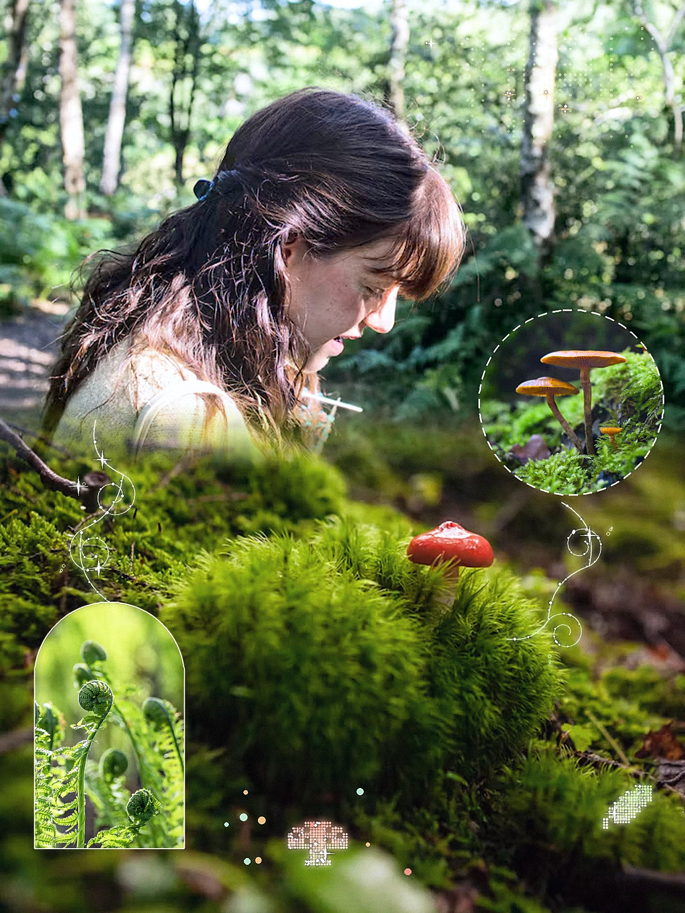
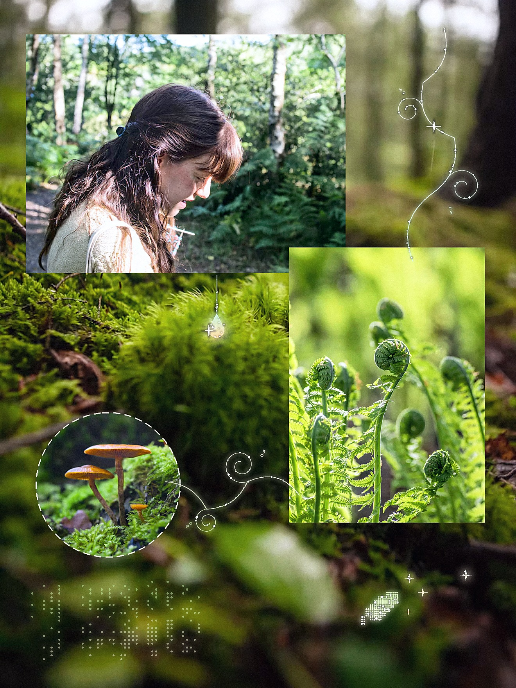
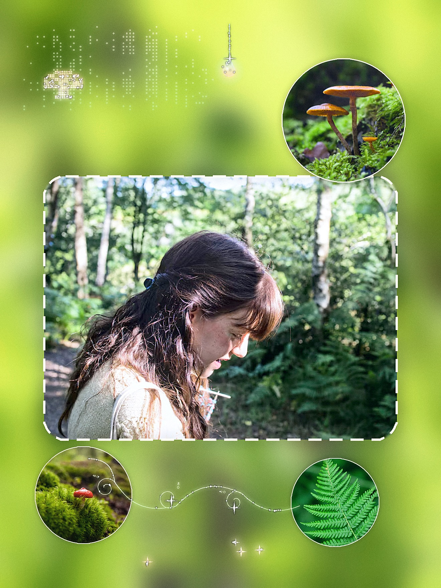
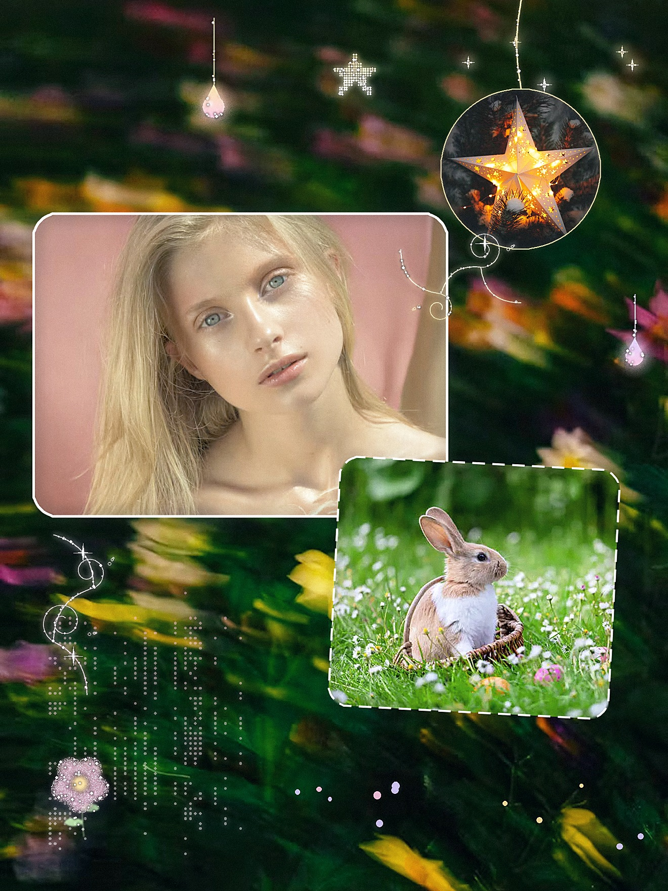
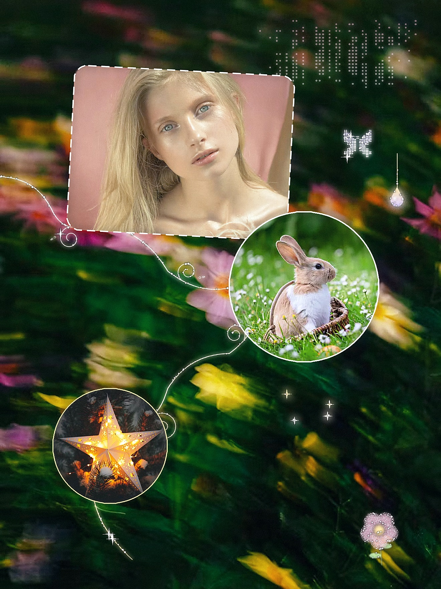

# 🌿 Forest Collage · 森林手账拼贴

An **Agent Skill** that turns your own photos into 3:4 forest-scrapbook collages, ready to post on Xiaohongshu / Instagram.

一个 **Agent Skill**：把你的真实照片自动拼成 3:4 竖版森林手账风拼贴，可以直接发小红书。基于开放的 SKILL.md 格式，可在支持 Agent Skills 的 AI 工具中使用。

<table>
  <tr>
    <td></td>
    <td></td>
    <td></td>
  </tr>
  <tr>
    <td></td>
    <td></td>
    <td></td>
  </tr>
</table>

## ✨ 风格 Style

- **真实照片为主，装饰为辅**：照片占画面绝大部分，装饰只做点缀。
- **照片之间有关系，不是规矩拼图**：错位叠放、柔和叠印、抠图出框、手绘藤蔓跨图连接，每页至少用两种手法。
- **明亮清透的森林绿**：富士直出式的小清新色调；人物照偏浅，景物照偏深，形成层次；一页只用一个色系。
- **原创装饰**：白色手绘藤蔓、点阵小图案、点阵纹理、光滴和少量闪光。

## 🧩 10 种构图模板 Templates

| 模板 | 做法 |
| --- | --- |
| A 上下软拼接 | 两张同地点照片上下渐变拼接，接缝上有东西跨过 |
| B 叠印过渡 | 2–3 张场景照边缘渐变融合 |
| C 大块叠放 | 植物近景作底，大块照片错位压角 |
| D 框图散点 | 异形框小图沿对角线散布在留白里 |
| E 风铃悬挂 | 小图用细线从上沿挂下来 |
| F 主图环绕小圆 | 背景虚化，一张主图 + 几个小圆环绕 |
| G 叠印融合 | 环境照半透明叠进人物照的天空或留白 |
| H 局部出框 | 人物头部伸出框外 |
| I 剪影窗 | 抠出的人站在形状窗前，窗里是另一处风景 |
| J 线索串联 | 一条长藤蔓依次串起几张小图 |

## 🔄 工作流程 How it works

1. **测量**：脚本自动找人脸、主体、留白和倾斜。
2. **方案**：AI 先用文字说明主图、布局、装饰和风险，并出 3 个版式草图供选择。
3. **出图**：确认版式后再加装饰，渲染成品。
4. **自检**：脚本按规则检查（人脸是否被挡、手法是否够两种等），再对照常见问题清单自查。

> 分工：脚本负责测量和执行，AI 负责审美判断和故事逻辑。

## 📦 使用 Usage

**环境要求**：AI 工具需要能读写文件、运行 Python 3、查看图片，首次运行时能联网（安装依赖、下载人脸模型和手写字体）。

**在支持 Agent Skills 的工具中**（如 Claude、OpenAI Codex 等）：
1. 下载本仓库，按该工具的方式安装为 Skill（例如把整个文件夹打包成 zip 上传，或放进工具的 skills 目录）。
2. 在对话里发照片，说"帮我做拼贴"。

**在其他能运行代码的 AI 工具中**（如 Cursor、Gemini CLI 等）：
1. 把仓库下载到本地项目里。
2. 告诉 AI："读 `SKILL.md`，按里面的流程用我的照片做一张拼贴"。

首次运行会执行 `scripts/setup.sh` 完成环境准备。

> 本 Skill 在 Claude 上开发和调试；换用其他模型时，选版式、配色等审美判断的效果可能有所不同。

```
forest-collage/
├── SKILL.md          # 主说明：流程、模板、规则
├── scripts/          # setup.sh · analyze.py（测量）· collage.py（渲染）· lint.py（检查）
├── templates/        # A–J 构图示意图
├── references/       # 元素参数、构图片段
└── examples/         # 参考图及说明
```

## 📄 License

- 代码与文字：[MIT License](LICENSE)
- `examples/` 中的参考图由本 Skill 生成，照片素材来自 [Unsplash](https://unsplash.com)，遵循 [Unsplash License](https://unsplash.com/license)。
